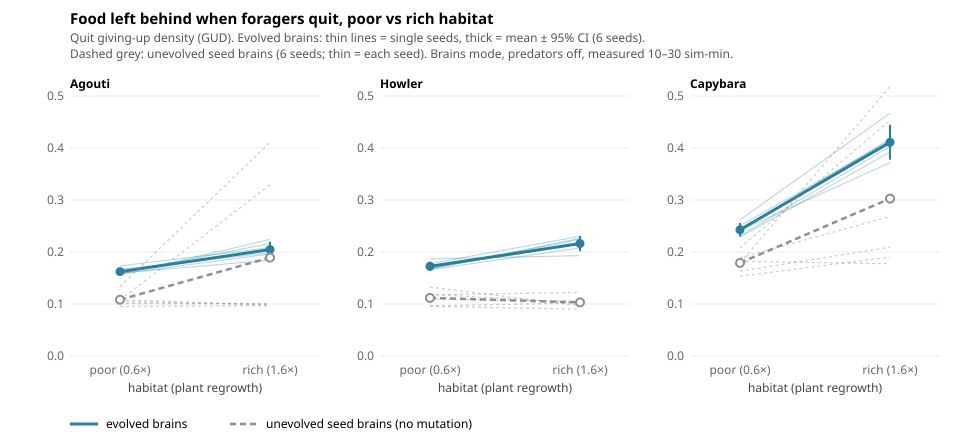

# Vivarium: what two days of looping produced

*Nov 2–4, 2026 · branch `claude/sweet-planck-lhh90j` (nothing merged to `main`; GitHub Pages untouched) · ~45 cycles, plus a local session for the classroom UI. The day-by-day record is `LOOP_LOG.md`.*

## In one paragraph
Vivarium went from a fun evolution sim to a working **ethology instrument** and **field-methods classroom**:
- Runs are bit-for-bit reproducible.
- Every animal's life, behaviour and foraging decisions can be logged.
- Experiments run headless with controls and paired seeds.
- Two research questions were taken to a real answer, and every measurement trap met along the way was turned into teaching material.

## Research results
| question | answer | write-up |
|---|---|---|
| **Do evolved foragers follow the marginal value theorem?** | **Yes, qualitatively.** They leave more food behind in richer habitats, in every species. Paired over 6 seeds: agouti +0.042 (+0.025 to +0.060), howler +0.044 (+0.023 to +0.064), capybara +0.168 (+0.143 to +0.193). The response is **plastic** (a transplant test), **mostly evolved** (an unevolved null shows little of it), and an **active departure** from food that's still there. There's no extra caution under predation risk. Which cue tells them a habitat is rich is unresolved: visible-food quality *can* drive leaving but isn't necessary. | [`docs/mvt-findings.md`](mvt-findings.md) · figure [`figures/mvt-gud.svg`](figures/mvt-gud.svg) |
| **Does an evolved many-eyes effect appear** (less vigilance in bigger groups)? | **No, robustly.** Seven pilots plus evolvability and selection tests. These networks never evolve proactive scanning: vigilance evolves *down*, because a head-up second costs food. | [`docs/many-eyes-findings.md`](many-eyes-findings.md) |
| Does a hybrid penalty make mate choice pickier (reinforcement)? | No: hybrids are too rare for the penalty to matter. | `experiments/out/reinforcement-pilot/` |
| Why do harpy eagles decline under trait costs? | A bottom-up cascade: their prey becomes less productive. | `LOOP_LOG.md`, cycle 22 |

## Teaching (Field tab), classroom-ready
- **Four methods, scored against ground truth no real field site has:**
  - **focal sampling** (κ, confusion table, observer vs sampling error);
  - **scan sampling** (counting vs placement error);
  - **feeding trays** (giving-up densities in rich vs poor habitat, prediction first);
  - **mark–recapture** (Lincoln–Petersen and Chapman estimates against the true population; closure and precision).
- **Class link** `index.html?seed=1234&mode=brains#field`: every student gets the same world (local session). It's backed by a fixed-step clock, so linked worlds stay identical.
- **CSV downloads** for all three methods, ready to pool across a class (local session).
- **Phone-tested** (local session): prompts, scan circle, keyboard and dark mode fixed.
- **Handouts** (`docs/handouts/`): one page per method, with instructor answers.
- **Case studies** (`docs/case-studies/`), built on real data: "Is it vigilance or walking?" (definition trap) and "Does vigilance pay?" (immortal-time bias).
- **Class results page** `class.html`: drop in the class's CSVs and get pooled results (verified end to end against an independent recomputation).
- **Accessibility:** WCAG AA text contrast in both themes; tray habitats differ by shape as well as colour.
- **Instructor quick-start:** [`docs/INSTRUCTOR-QUICKSTART.md`](INSTRUCTOR-QUICKSTART.md), a first lab in 10 minutes plus the feedback to collect. Full guide: [`docs/teaching-field-methods.md`](teaching-field-methods.md).

## Measurement traps caught (each one is now a lesson)
| trap | where it bit |
|---|---|
| Counting walking as "vigilance" | Faked a many-eyes effect, and a reversed one in capybaras (case study A) |
| Group size confounded with food | Made vigilance look like it fell with group size, even without predators |
| Immortal-time bias | Made a little vigilance look optimal (case study B) |
| Head up on bare ground counted as vigilance | Confounded per-animal selection estimates |
| A probe shows an input *works*, not that animals *depend* on it | MVT cue (cycles 41 → 43) |
| A float-order change and frame-rate steps | Broke reproducibility. Both caught by fingerprint checks: one in the headless runs, one by the local session in live browser runs |

## Tools added (all switches off by default; default runs bit-identical, fingerprint `7ab26d53`)
- **Run outputs:** life table, ethogram, patch log (feeding bouts and GUDs).
- **Headless runner options:** mid-run schedules (`--at`).
- **Network probes:** `probe-brains.js`, `probe-quit.js`.
- **Analysis scripts:** `analyze_cohorts.py`, `analyze_patches.py`, `analyze_mvt_replication.py`, `figure_mvt.py`.
- **Experiment switches:** `headDownSense`, `scanIntake`, `births`, `foliageTo`, `foodSense`, `pullClamp`.

How-to: [`docs/experiments.md`](experiments.md).

## How to continue
- **Teach with it:** the next step is **one real trial**. Hand a teacher or TA `docs/INSTRUCTOR-QUICKSTART.md` and collect the feedback it lists. Not yet tested on Safari, Firefox or a physical phone.
- **Research next:** what cue tells evolved foragers a habitat is rich (clamp several inputs at once); GUDs within one landscape (risky vs safe areas); more seeds for the follow-up tests, which use 2 seeds each.
- **Before merging to `main`:** decide on the fixed-step clock (it changes live runs slightly, to match headless runs), and glance at the Arena (a match was played and checked, but only partly watched live).
- Collaboration pattern that worked: one cloud and one local session on the same branch, with a file-ownership table in `LOOP_PLAN.md` and `[cloud]` / `[local]` entries in `LOOP_LOG.md`.
