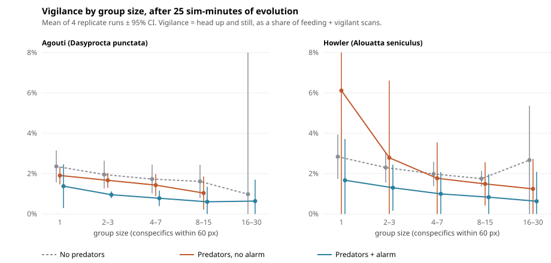

# Does an evolved many-eyes effect emerge in Vivarium?

*A pilot series, cycles 13–16, 20 and 25 (Nov 2026). Methods note plus results; about 10 minutes to read.*

## Question

The **many-eyes effect** is one of the most replicated patterns in behavioural ecology: in bigger groups each individual spends less time vigilant, because the group as a whole still detects predators (Pulliam 1973; reviewed by Elgar 1989). Vivarium's herbivores carry small neural networks whose weights evolve. Among their outputs is **head down**: an animal can only eat with its head down, and head-down shrinks its threat detection to 40%. So feeding against vigilance is a real trade-off that selection can act on, and no rule tells an animal how vigilant to be.

**Question:** does selection on those networks produce vigilance that falls with group size?

## Methods

**Model.** Vivarium (this repo), "brains" mode: every herbivore and predator runs an evolved network. Trait costs on (speed, senses, thrift and size each carry a price). Population caps ×1.6. Eight species on a 2400 × 1600 range: four herbivores (agouti, howler, capybara, tapir) and four predators.

**Runs.** Fixed-step headless runs (`tools/vivarium-run.js`) from a seed. The simulation draws from its own seeded generator, so a seed plus settings reproduces a run bit for bit; we checked this by re-running replicates standalone and matching final-state fingerprints. Each condition used seeds 1000–1003 (4 paired replicates). Runs were driven by `tools/experiment.js` from JSON specs in `experiments/`.

**Measurement.** Scan sampling at 1 Hz. Every sim-second, each animal is scored in one ethogram state, along with its **group size** (conspecifics within 60 px, itself included) and the **food level** under it (4 levels).
- *feed*: head down eating
- *vigilant*: head up **and** below 25% of top speed (a scan)
- *travel*: head up and moving
- *flee*

**Vigilance** = vigilant / (feed + vigilant).

**Analysis** (`tools/analyze_vigilance.py`). The unit of analysis is the **replicate run**, never the scan. Scans within a run share animals, predators and moments, so pooling them would give falsely narrow intervals. Per run and species, one weighted least-squares slope of vigilance on log₂(group size), weighted by scans: *percentage points per doubling of group size*. The **food-adjusted** slope adds fixed effects for food level, so it is fitted within food levels and then pooled. Across the 4 replicates: mean and 95% t interval.

**Prediction.** If an evolved many-eyes effect exists, the food-adjusted slope is negative **with predators** and flat **without** them. The no-predator condition is the control: without predators, nothing should tie vigilance to group size.

## Results

Each pilot changed the interpretation, and each time for a reason we measured.

| pilot | design change | what we learned |
|---|---|---|
| 1 (cycle 13) | first run, "vigilant" = head up | Agoutis and howlers looked like many-eyes (−1.2 and −0.9 pp per doubling, 4/4 replicates). Capybaras and tapirs showed the *opposite*. |
| 2 (cycle 14) | vigilance redefined as head-up **and still**; **no-predator control** | Most of the old "vigilance" was **walking** (travel is 4–27% of time; real scanning 1–8%). Capybara's "rising vigilance" collapsed from +4.1 to +0.4 pp. And agoutis and howlers showed the falling pattern **even with no predators** (−0.8 pp both), so it was never anti-predator. |
| 3 (cycle 15) | **food covariate**; 25 min of evolution before measuring | Group size and food are confounded: agoutis are on rich food in 6% of solo scans but 28% of scans in groups of 8–15. Food-adjusted, with predators: **no reliable slope** in any species. Without predators, agoutis (−0.45, CI −0.75 to −0.16) and howlers (−0.35, −0.60 to −0.10) still decline. |
| 4 (cycle 16) | **alarm contagion**: a herbivore that sees a fleeing conspecific perceives its predator | Alarm **roughly halves vigilance at every group size** (agouti 1.4% → 0.8%, howler 1.7% → 0.9%) and **protects howlers** (0/4 population crashes vs 2/4). But there is **still no group-size gradient**: every food-adjusted slope's interval spans 0. |
| 5 (cycle 20) | **graded alarm**: each fleeing detector passes the warning at rate λ, so k detectors warn k× faster (λ = 1 and 4 per s) | **Still no gradient**: all food-adjusted intervals span 0 at both rates (agouti −0.17, −0.44 to +0.09 at λ = 4; howler −0.03, −0.15 to +0.09 at λ = 1). Howlers again avoid crashes (120–999 at the end vs 3–356 without alarm). |
| 6 (cycle 25) | **head-down detection 40% → 20%** ("raise the price of not looking"), no alarm vs graded alarm λ = 1 | **The floor didn't lift**: vigilance stays at 1–3%, and animals simply detect, and flee, less (agouti flee 3.5–4.7% vs 5.7–8.0%). One hint: agoutis with graded alarm show a negative food-adjusted slope whose interval excludes 0 (−0.23, −0.44 to −0.03, 4/4 replicates). But it's 1 of 8 tests, and agoutis without predators showed a similar slope in pilot 3, so it needed a control. **Checked in cycle 26: it isn't many-eyes.** With no predators the head-down setting can't matter, and a re-run proved pilot 3's no-predator runs are bit-identical at 20%. Against that control, predators + alarm make the agouti slope *shallower* in 4/4 seeds (paired +0.22, +0.09 to +0.35; howler +0.59, 4/4). |



*Figure: pilots 3 and 4 (same seeds and setup). Points are means of 4 replicate runs ± 95% CI; bins with fewer than 2 replicates having ≥50 scans are omitted. Generated by `tools/figure_many_eyes.py`.*

### Inside the networks (cycle 27)
`tools/probe-brains.js` takes every living evolved-brain herbivore after 25 sim-min (seeds 1000 and 1001, predators on), keeps its *actual* current inputs, and edits only the threat or group inputs before running the network. Share of brains choosing head **down**:

| | no threat | predator close ahead | lifts head when a threat is sensed | alone | crowded |
|---|---|---|---|---|---|
| agouti (evolved, seeds 1000 / 1001) | 88% / 93% | 3% / 2% | 96% / 98% | 90% / 93% | 89% / 91% |
| howler | 87% / 91% | 2% / 0% | 97% / 100% | 90% / 90% | 84% / 90% |
| capybara | 85% / 84% | 1% / 1% | 98% / 99% | 85% / 84% | 84% / 81% |
| tapir | 65% / 61% | 0% / 0% | 100% / 100% | 80% / 69% | 59% / 57% |
| hand-wired seed brains | 75–99% | 0% | 100% | 77–97% | 71–99% |

**This is the mechanism behind the floor.** The networks are *reactive*: they eat head-down until a threat is sensed, then look up (96–100% do). Because head-down detection is reduced but never zero (40%, or 20% in pilot 6), threats still get noticed, so "eat until you notice, then react" works and proactive scanning never pays. Group inputs barely move the decision, and where they do (tapirs) crowded animals are *more* often head-up, the opposite of many-eyes. Raw probe output: `experiments/out/brain-probe/`.

**The decisive test is blind feeding** (head-down detection 0). Then the only ways to spot a predator are looking up first or being warned by others, which is the situation the many-eyes effect is about.

## Interpretation

1. **No evolved many-eyes effect under these conditions.** With predators, vigilance doesn't reliably fall with group size once food is controlled for: not without alarm, not with instant alarm, and not with graded alarm at two rates.
1b. **Most likely reason: a floor effect, and it isn't only about payoff.** Pilot 6 made head-down twice as blind and vigilance still didn't rise. Evolved vigilance sits at only **1–2% of foraging time in every condition**, which leaves almost no room for a decline. Head-down only shrinks threat detection to 40% (and alarm covers much of the rest), so scanning barely pays and selection pushes it towards zero. In real systems vigilance is often 10–50% of foraging time. The informative next test is to make head-down costlier (e.g. detection at 20%) so baseline vigilance rises and a gradient has room to appear.
2. **The mechanism matters, and the model makes it testable.** The many-eyes effect needs collective detection: neighbours' vigilance has to benefit you. Without alarm contagion it doesn't (pilot 3). With alarm it does, and animals respond by cutting vigilance substantially. But the benefit saturates at a single neighbour (one fleeing conspecific within 80 px is enough), so a bigger group adds nothing further. Real collective detection improves with every extra watcher (earlier detection, more directions covered). The current alarm doesn't model that, which is the most likely reason the gradient is absent.
3. **Measurement choices could have produced a false positive twice.** Counting head-up travel as vigilance (pilot 1) and ignoring the food confound (pilots 1–2) would each have produced a convincing but wrong "many-eyes effect". Field studies face the same two traps (vigilance definitions and resource-dependent group size), which is part of why this is useful for teaching.
4. **A residual group-size effect exists without predators** (agoutis and howlers, pilot 3), and predators make it *weaker*, not stronger (cycle 26: paired by seed, 4/4 for both species). It isn't anti-predator by construction. One possibility worth testing: under predation, groups are where predators hunt (they target dense prey), which would push vigilance *up* in groups and offset a non-predator decline. Its cause in the networks isn't identified; the herbivore networks see kin direction, kin proximity and crowding, and any of those could tie head-up stillness to group size.

## Limitations

- n = 4 replicates per condition; several intervals are wide (howler, with predators). These are pilots, intended to size a real experiment.
- 25 sim-minutes of evolution is short: roughly 60 agouti generations by the code's own estimate (~25 per 10 sim-minutes), and far fewer for the slow breeders (tapirs, predators). Brains may still be close to their hand-wired starting weights.
- Predation in brains mode is sparse and uneven (cycle 22 traced the harpy part of this to a bottom-up cascade: under trait costs agouti productivity falls ~30% and harpies, already starvation-limited, drop below replacement); harpies 4–16 and jaguars 2–9 at the end of the pilot 3–4 predator runs), so selection for vigilance is weaker than in a real predator-rich system.
- Capybaras sit at their (raised) population cap throughout, so their group sizes partly reflect saturation.
- Parameters are hand-tuned rather than fitted to field data. Results are statements about this model's selection dynamics, not about real agoutis.

## Next steps

1b. **Blind feeding** (head-down detection 0), with no alarm vs graded alarm; the cycle 27 probe shows why every earlier setting let reactive vigilance replace scanning.
2. **Power.** 10+ replicates and ~1 h runs, after sizing from these pilots' variance.
3. **The no-predator residual.** Probe the evolved networks' response to group-size inputs directly (hold everything else fixed and vary the kin and crowding inputs).

## Reproducing

```bash
node tools/experiment.js experiments/many-eyes-pilot3.json --parallel 4
node tools/experiment.js experiments/many-eyes-pilot4.json --parallel 4
python3 tools/analyze_vigilance.py experiments/out/many-eyes-pilot4
python3 tools/figure_many_eyes.py
```

Tidy CSVs (`runs.csv`, `populations.csv`, `budgets.csv`, `vigilance.csv`), each pilot's `report.md` and `spec.json` (with code version) are committed under `experiments/out/`. The day-by-day record, including the bugs found along the way, is in `LOOP_LOG.md`.

## References

- Elgar, M. A. (1989). Predator vigilance and group size in mammals and birds: a critical review of the empirical evidence. *Biological Reviews*, 64(1), 13–33.
- Pulliam, H. R. (1973). On the advantages of flocking. *Journal of Theoretical Biology*, 38(2), 419–422.
