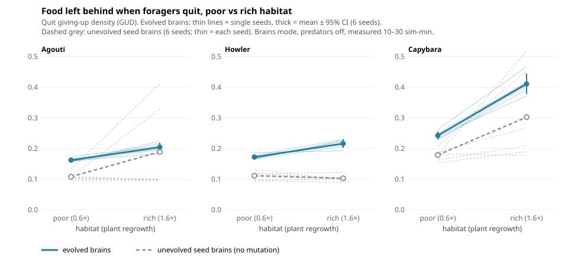

# Do evolved foragers obey the marginal value theorem?

*Pilot, transplant, predation-risk, network probes, null model and how-bouts-end tests, cycles 32–43 (Nov 2026). About 12 minutes to read.*

## Question

The **marginal value theorem** (Charnov 1976) says a forager should leave a food patch when its intake rate there drops to the average rate it can get across the whole habitat. The most-tested field prediction follows directly: in a **richer habitat**, the average rate is higher, so foragers should give up sooner and leave **more food behind**. Ecologists measure this as the **giving-up density** (GUD; Brown 1988), the food left in a patch when the forager quits.

Vivarium's herbivores have two lineages living side by side in "Mixed" worlds:
- **Evolved brains:** neural networks whose weights evolve.
- **Instinct:** a fixed rule: graze head-down whenever the food underfoot is above 0.15.

The Instinct rule has no notion of habitat quality, so it is a built-in control. The question: **do evolved brains' GUDs track habitat quality, the way MVT predicts, while Instinct's don't?**

## Methods

- **Runs.** Mixed mode (both lineages in one world), trait costs on, population caps ×1.6, **predators off**, so that feeding bouts end by choice rather than by fleeing. 30 sim-min, measured from 10 min onward (`ethoFrom` 600). Habitat quality was set by plant regrowth, `growth` 0.6 / 1.0 / 1.6. Seeds 1000 and 1001 (2 replicates per level).
- **Measurement** (`Vivarium.patchLog(true)`, `vivarium-run.js --patches 1`):
  - A **feeding bout** starts when a herbivore takes food and ends when it hasn't eaten for 2 s.
  - The **quit GUD** is the food left in the last cell it ate from: the active decision to stop.
  - The **move GUD** is the food left in a cell each time a feeding animal drifts on to the next one. It is largely passive, and serves as a contrast.
- **Analysis.** `tools/analyze_patches.py` reports the mean over replicates ± half-range.

## Results

Quit GUD (food left when a bout ends), mean of 2 seeds:

| species | brains, growth 0.6 / 1.0 / 1.6 | instinct, growth 0.6 / 1.0 / 1.6 |
|---|---|---|
| agouti | 0.127 / 0.159 / 0.208 | 0.102 / 0.105 / 0.106 |
| capybara | 0.246 / 0.285 / 0.366 | 0.152 / 0.152 / 0.156 |
| howler | 0.145 / 0.172 / 0.188 | 0.106 / 0.113 / 0.109 |
| tapir | — / 0.324 / 0.405 | too few bouts |

- **Brain GUDs rise with habitat quality in every species, in both seeds** (8 of 8 seed × species series rise monotonically; tapirs nearly died out at 0.6). From the poorest to the richest habitat, agouti GUD rises 64% and capybara 49%.
- **Instinct GUDs stay flat** (within ±0.01), as a fixed threshold should.
- That contrast also rules out a measurement artefact: both lineages share the same worlds, so if richer habitats inflated GUDs just because food regrows during the 2 s bout gap, Instinct would rise too.
- **Move GUDs rise for both lineages** (e.g. agouti instinct 0.24 → 0.32). That's what passive drift through a richer landscape gives. Only the active quit decision separates the lineages.
- Brains also quit at higher food than Instinct at every growth level: they leave patches that the rule would keep grazing.

Raw output: `experiments/out/mvt-pilot-c32/`, `mvt-transplant-c33/`, `mvt-risk-c34/`, `quit-probe-c35/`, `mvt-null-c36/`, `mvt-quit-context-c40/`, `leave-probe-c41/`, `mvt-blind-c42/`, `mvt-clamp-c43/`, `mvt-replication-c44/` (`gud.txt`, plus each run's `patches.json` and manifest).

### Replication: 6 seeds (cycle 44)
Brains mode, evolved, predators off, growth 0.6 vs 1.6, seeds 1000–1005 (cycle 40's two seeds plus four new ones). Paired by seed, analysed with `tools/analyze_mvt_replication.py`:

| growth 1.6 − 0.6 | Δ quit GUD (95% CI) | seeds positive | Δ share of quits made on food (95% CI) | seeds positive |
|---|---|---|---|---|
| agouti | +0.042 (+0.025 to +0.060) | 6/6 | +0.13 (+0.07 to +0.19) | 6/6 |
| howler | +0.044 (+0.023 to +0.064) | 6/6 | +0.10 (+0.02 to +0.17) | 5/6 |
| capybara | +0.168 (+0.143 to +0.193) | 6/6 | +0.12 (+0.08 to +0.16) | 6/6 |
| tapir | +0.30 (+0.24 to +0.35) | 2/2 | +0.49 (wide) | 2/2 |

**The main result holds with proper intervals:** in every species, richer habitat means more food left behind and more departures from food that's still there. (Tapirs reach 20 voluntary quits at both levels in only 2 of 6 seeds.) Output: `experiments/out/mvt-replication-c44/`.



*Figure: quit giving-up density at growth 0.6 vs 1.6. Evolved brains: 6 seeds (thin lines) with mean ± 95% CI. Unevolved seed brains: 2 seeds (dashed; for agoutis the two seeds disagree, one flat and one jumping, as the null-model table below reports). Generated by `tools/figure_mvt.py` from committed patch logs.*

### Plasticity or evolution? A transplant test (cycle 33)
Cycle 32's populations evolved for 30 min at their own growth level, so the GUD differences could be either:
- the same kind of network reacting to a richer landscape (behavioural plasticity, the mechanism MVT describes), or
- networks that evolved differently in each habitat.

**Design:**
- Every world evolves at growth 1.0 for 30 min.
- At 30 min, three things happen at once: growth switches to 0.6, 1.0 or 1.6; the standing food is rescaled to that level's equilibrium (`params.foliageTo`); and **mutation stops**.
- GUDs are measured over the next 1–3 min, about one agouti generation, so selection has almost no time to act.

Seeds 1000 and 1001, via `--at`.

| brains, quit GUD at growth 0.6 / 1.0 / 1.6 | transplanted (all evolved at 1.0) | evolved in place (cycle 32) |
|---|---|---|
| agouti | 0.139 / 0.173 / 0.243 | 0.127 / 0.159 / 0.208 |
| capybara | 0.241 / 0.293 / 0.458 | 0.246 / 0.285 / 0.366 |
| howler | 0.136 / 0.167 / 0.202 | 0.145 / 0.172 / 0.188 |
| tapir | 0.242 / 0.416 / 0.500 | — / 0.324 / 0.405 |

**The response is plastic.** Animals that all evolved in the same habitat shift their GUDs within two minutes of the switch, in every seed × species series with enough bouts (7/7 rise monotonically). The shift is as large as the between-habitat differences in cycle 32, or larger. So cycle 32's pattern needs no evolutionary divergence: the evolved networks carry a general rule that makes them quit at higher food when the landscape is richer, which is what MVT predicts a well-designed forager should do. (The 0.6 landscape overshot to 0.31 mean foliage rather than 0.356, because grazing continued after the rescale; that strengthens the low-growth contrast slightly but doesn't change the order.)

*An earlier version with births switched off failed: lifespans are so short that every population emptied within ~2–3 min, before the window opened. That run is kept in `experiments/out/mvt-transplant-c33/births-off-failed/`.*

### Predation risk (cycle 34): no Brown effect
Brown (1988) predicts that foragers give up at **higher** food where predation risk is higher, because each extra minute in the patch carries a risk cost. Test: growth 1.0 with predators on (seeds 1000 / 1001), against cycle 32's predator-free growth-1.0 runs (same seeds and settings).

| brains | quit GUD, predators off | predators on | share of bouts ended voluntarily (on) |
|---|---|---|---|
| agouti | 0.159 | 0.141 (1 seed with ≥ 20 quits) | 4% |
| capybara | 0.285 | 0.275 | 3% |
| howler | 0.172 | 0.171 | 2% |
| tapir | 0.324 | 0.251 (1 seed) | 11% |

- **Quit GUDs don't rise under risk; if anything they fall.** This holds even though the landscape is a little *richer* with predators on (habitat intake: agouti 1.03 → 1.21), which by itself should push GUDs up.
- **Instinct is flat as expected:** 0.10–0.16 either way.
- **Why the absence fits:** the cycle 27 network probe showed these brains are *reactive*. They respond to a predator they can sense, but nothing in them represents background risk, so there's nothing that could raise a quitting threshold.
- **Measurement caution:** with predators on, only 2–11% of bouts end voluntarily; the rest end in flight. Voluntary quits are therefore a sample of moments when no predator was near, which biases this test against finding a risk effect. Field GUD trays have the same problem in reverse: they record food left but not why the forager left.

### What drives the quit decision? (cycles 35–36)
**Network probe** (`tools/probe-quit.js`, growth 0.6 / 1.0 / 1.6, seed 1000). For every evolved herbivore, its actual inputs were kept, threat removed, and "food here" swept from 0 to 1 to find its **grazing threshold**: the food underfoot at which it puts its head down. The sweep was repeated with "food pull" (the best food it can see nearby) at 0 / 0.5 / 1, and with energy at 0.3 / 0.6 / 0.9.
- Thresholds are low (medians 0.04–0.20) and barely move: ±0.04 with visible food (no consistent direction), ±0.02 with energy.
- They also sit below the measured GUDs.
- So the GUD response isn't a threshold that compares the patch with visible alternatives, or with hunger.

**Is it just landscape mechanics?** Animals graze while drifting, and a bout ends when they walk onto poor ground, so in a richer landscape the cell they last ate from may simply hold more food. *(The Instinct control can't rule this out: Instinct animals eat whenever any food is present, so their bouts end only on bare ground, a different measurement path.)*

**Null model** (cycle 36). Every animal runs the identical, never-evolved hand-wired seed brain (`mutationRate` 0 from the start; headless founders are exactly the seed brain), growth 0.6 vs 1.6, seeds 1000 / 1001:

| quit GUD, growth 0.6 → 1.6 | unevolved seed brains | evolved brains (cycle 32) |
|---|---|---|
| agouti | 0.105 → 0.099 (s1000), 0.108 → 0.329 (s1001) | 0.127 → 0.208 (both seeds rise) |
| capybara | 0.173 → 0.193 (s1001 falls) | 0.246 → 0.366 |
| howler | 0.107 → 0.112 | 0.145 → 0.188 |
| tapir | — → 0.227 | — → 0.405 |

- **There is a mechanical component, but it's small and inconsistent:** +0.005 for howlers, +0.02 for capybaras (one seed falls), and agoutis flat in one seed with an unexplained jump in the other.
- **The evolved response is several times larger and rises in every seed.** So evolution added something real on top of the mechanics.
- **No single input moves the threshold.** Visible food, energy, and density were all ruled out: a crowding sweep (`--vary crowd`, kin proximity + crowding 0 → 1, cycle 37) shifts evolved thresholds by ±0.03 in mixed directions.
- **The likely explanation is in the movement.** A bout ends when an animal *walks off* onto poorer ground, not when it lifts its head on good ground. So the evolved difference is probably in the movement policy while grazing (throttle and turning, which decide when and where an animal drifts on), not in the head-down decision these probes looked at. The quit-GUD measures where an animal was when it stopped eating; the "decision" may be a by-product of how it moves through the landscape.

### How do bouts end? (cycle 40)
At each voluntary quit, the patch log now records the food under the animal at that moment and its speed. An animal still standing on grazeable food (≥ 0.15) **stopped eating while food remained**; one on poorer ground **walked off**. Brains mode, predators off, evolved (mutation 0.07) vs unevolved seed brains (mutation 0), growth 0.6 vs 1.6, seeds 1000 / 1001. The unevolved runs reproduce cycle 36's fingerprints exactly.

| quit while still on food, growth 0.6 → 1.6 | evolved brains | unevolved seed brains |
|---|---|---|
| agouti | 37% → 54% | 11% → 40% (seeds disagree: 0.07 vs 0.73 at 1.6) |
| capybara | 67% → 82% | 48% → 39% |
| howler | 44% → 58% | 9% → 12% |
| tapir | 31% → 88% | — → 32% |

- **Evolved brains actively leave food that's still there.** They quit on grazeable food far more often than the unevolved policy, and they are moving at 50–85% of top speed when they do: they lift their heads and go.
- **They do this more in richer habitats, in every species.** That's the behavioural signature the marginal value theorem predicts: leave a patch with food remaining when the alternatives are good.
- **The unevolved policy mostly drifts off.** Howlers end 88–91% of bouts by wandering onto poor ground.
- This resolves the cycle 35–37 puzzle. The head-down probes found no shifting grazing threshold because the evolved change is in the **movement outputs**: evolved brains walk away from food sooner, and more so where food is plentiful.

### The cue: visible food (cycle 41)
`probe-quit.js --measure leave` puts each evolved herbivore on good food (food here 0.4), with no threat. It reports the share of brains whose outputs say **leave**: throttle above 0.55 (the sim's running level) or head up. One input is varied at a time: food pull (the best food it can see within sensing range, less a distance cost: an absolute amount, not relative to the current patch), energy, or crowding. Seed 1000, growth 0.6 and 1.6, 400 brains per species (13 tapirs at 0.6).

| share saying "leave" on good food, food pull 0 → 0.5 → 1 (growth 1.6) | evolved | hand-wired seed brain |
|---|---|---|
| agouti | 22% → 36% → 40% | 12% → 13% → 13% |
| howler | 20% → 34% → 42% | 17% → 23% → 23% |
| capybara | 28% → 56% → 67% | 0% → 15% → 18% |
| tapir | 23% → 60% → 78% | 4% → 12% → 14% |

- **Visible food is the cue.** Evolved brains leave a good patch when they can see better food, and the effect is steep. It's similar at growth 0.6 (capybara 33% → 79%, agouti 22% → 56%). The seed brain responds weakly, except for one odd case: howler seed brains at growth 0.6 jump to 100%.
- **Energy has no effect** (±3 pp).
- **Crowding has a modest effect** in agoutis, capybaras and tapirs (e.g. agouti 17% → 30%, tapir 9% → 24% at growth 1.6), and none in howlers.
- **The full mechanism:** in a richer habitat the best visible cell is usually richer, so evolved animals walk off a patch sooner and leave more food behind. That *is* a patch-versus-alternatives comparison, the core of the marginal value theorem. It is made in the movement outputs, which is why the head-down threshold probes (cycles 35, 37) missed it.
- Caveat: one seed, and a static probe of single inputs. Real decisions combine inputs over time (the networks have memory outputs).

### Behavioural test 1: shorter food sight (cycle 42)
Cycle 33's transplant design, with food sensing cut to 30% of normal range at the switch (`params.foodSense` 0.3). Seeds 1000 / 1001. A full-vision rerun reproduced cycle 33's fingerprint exactly (`4aecc9e1`).

| rich − poor quit-GUD gap (to growth 0.6 → 1.6) | full vision (cycle 33) | food sight 30% |
|---|---|---|
| agouti | 0.139 → 0.243 (0.10) | 0.158 → 0.246 (0.09) |
| capybara | 0.241 → 0.458 (0.22) | 0.187 → 0.311 (0.12) |
| howler | 0.136 → 0.202 (0.07) | 0.131 → 0.207 (0.08) |
| tapir | 0.242 → 0.500 (0.26) | 0.163 → 0.223 (0.06; one seed at 1.6) |

- **Mixed.** The gap roughly halves for capybaras and mostly disappears for tapirs; agoutis and howlers are unchanged.
- **The test isn't clean.** Even at 30% range, a rich habitat's *nearby* cells are richer, so the visible-food input still carries the habitat cue; shrinking the range weakens the cue rather than removing it. It also changes steering.
- The sharper test is to hold the food-pull input constant while keeping food direction (so animals still steer to food). Then the networks can't tell rich from poor through that input at all.

### Behavioural test 2: hide visible-food quality (cycle 43)
`params.pullClamp` 0.5 at the switch. Any visible food registers at a fixed strength, and its direction stays real, so animals still steer to food but can't tell good from poor alternatives. Same transplant design, seeds 1000 / 1001.

| rich − poor quit-GUD gap | full vision (c33) | 30% sight (c42) | quality hidden (c43) |
|---|---|---|---|
| agouti | 0.10 | 0.09 | 0.12 (0.148 → 0.264) |
| capybara | 0.22 | 0.12 | 0.17 (0.225 → 0.394) |
| howler | 0.07 | 0.08 | 0.06 (0.148 → 0.209) |
| tapir | 0.26 | 0.06 | 0.32 (0.240 → 0.559; small n) |

**The gap survives.** Visible-food quality is *not necessary* for the habitat effect. The cycle 41 probe showed that the food-pull input *can* drive leaving, but in behaviour the habitat signal reaches the networks by other routes as well. Candidates include how fast food underfoot runs down, and the steering dynamics. A static, single-input probe can't separate these, so the cue remains open. This is a useful cautionary result: a probe can find an input that works without showing that the animals depend on it.

## Interpretation

- **Evolved foragers' giving-up densities rise with habitat quality**, qualitatively as the marginal value theorem predicts (cycle 32, 8/8 series).
- **The response is plastic** (cycle 33): animals evolved in one habitat shift within minutes of a switch.
- **It is mostly evolved, not mechanical** (cycle 36): an unevolved, identical policy shows only a small, inconsistent rise.
- **It's an active departure, carried by movement** (cycle 40): evolved brains quit while food remains far more often than an unevolved policy, more so in richer habitats, at speed.
- **What tells them the habitat is rich is unresolved.** In a static probe, visible-food quality drives leaving (cycle 41), but hiding it doesn't remove the habitat effect (cycle 43), so it isn't necessary. Other inputs, or their dynamics over time, carry the signal too. Hunger doesn't matter; crowding matters a little. The safe summary: evolved foragers leave food behind in rich habitats by moving on sooner, and they use more than one cue to do it. (Iwasa et al. 1981 discuss how information limits shape real foragers' rules.)
- That distinction matters. MVT describes what an optimal forager does; it doesn't say how. Real animals also use rules of thumb (e.g. quit after a fixed time, or after a run of unsuccessful bites; Iwasa et al. 1981), and a density rule can produce MVT-like patterns without any estimate of the habitat average.
- **No Brown effect** (cycle 34): GUDs don't rise under predation risk, consistent with the brains' purely reactive treatment of threats (`docs/many-eyes-findings.md`, cycle 27 probe).

## Limitations

- **Replication:** the core habitat effect has 6 seeds with 95% intervals (cycle 44). The follow-up tests (transplant, risk, null, blinding, clamp) are 2 seeds each.
- **Qualitative only.** MVT makes a quantitative prediction (leave when marginal intake = long-run average intake), and this pilot doesn't test it. Doing so needs each bout's marginal intake rate at leaving, compared with the habitat average including travel.
- **Cue unresolved.** Static single-input probes (cycles 35, 37, 41) find an input that *can* drive leaving (visible-food quality), but clamping it (cycle 43) shows it isn't necessary. The networks' memory outputs and the time course of food underfoot are untested.
- **The Instinct lineage isn't a like-for-like control** for quit-GUDs (its bouts end by a different route); the unevolved seed-brain null (cycle 36) is the better baseline.
- **Predators off.** With predators, bouts mostly end by fleeing (cycle 32 first look), so this is foraging in a predator-free world. GUDs under predation risk are their own classic topic (Brown 1988: GUDs rise with risk).
- The "patch" is a 20-px cell in a continuous landscape, not a discrete patch with travel between patches, so the travel-time prediction can't be tested yet.

## Next steps

0. ~~How bouts end~~ (cycle 40): evolved brains actively leave food. ~~Cue~~ (cycles 41–43): visible-food quality can drive leaving but isn't necessary. If reopened, clamp several inputs at once (food here, pull, crowding), or record each bout's input trace before quitting.

1. ~~More seeds~~: done (cycle 44, 6 seeds, all intervals exclude 0).
2. ~~Transplant test~~: done (cycle 33): plastic. Next: probe which inputs drive the quit decision.
3. ~~Predation risk~~: done (cycle 34): no Brown effect, consistent with reactive brains. A fairer test would record GUD for *every* bout end, fled or not, and compare spatially (risky vs safe areas).
4. **Quantitative MVT:** log the intake rate at leaving and compare it with the habitat's long-run average.

## Reproducing

```bash
node tools/vivarium-run.js --secs 1800 --seed 1000 --mode mixed --costs 1 --patches 1 \
  --set '{"capScale":1.6,"predators":false,"growth":1.6,"ethoFrom":600}' --out runs/mvt/g1.6-s1000
python3 tools/analyze_patches.py runs/mvt/*/patches.json
```

## References

- Brown, J. S. (1988). Patch use as an indicator of habitat preference, predation risk, and competition. *Behavioral Ecology and Sociobiology*, 22(1), 37–47.
- Iwasa, Y., Higashi, M., & Yamamura, N. (1981). Prey distribution as a factor determining the choice of optimal foraging strategy. *The American Naturalist*, 117(5), 710–723.
- Charnov, E. L. (1976). Optimal foraging, the marginal value theorem. *Theoretical Population Biology*, 9(2), 129–136.
